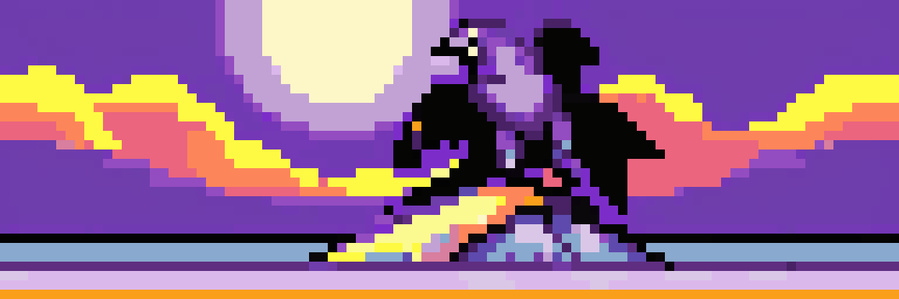

The parts of a game that only grow with human authoring (levels, set dressing, dialogue, villagers' lives, interfaces, weather) should grow with agents too. Bevy Coven is a coven of Bevy crates that work alone or together, written into one grimoire, the Grimoire editor, with its agent, the Familiar, at your side.

> ⚠️ **Vibe Coded.** Written by AI agents working from a human's direction, covered by tests rather than a line-by-line human review. Read the code before you rely on it for something you care about.

## The family

|Part|Crate|What it does|Latest|Docs|
|---|---|---|---|---|
|**The grimoire**|[bevy_grimoire](https://github.com/bevy-coven/bevy_grimoire)|An editor that learns a world's grammar from your example and builds more.||[docs.rs](https://docs.rs/bevy_grimoire) · [book](https://bevy-coven.github.io/crates/bevy_grimoire.html)|
|**World**|[bevy_elements](https://github.com/bevy-coven/bevy_elements)|Sky, weather, wind, clouds, terrain and water, simulated in compute shaders.||[docs.rs](https://docs.rs/bevy_elements) · [book](https://bevy-coven.github.io/crates/bevy_elements.html)|
||[bevy_flora](https://github.com/bevy-coven/bevy_flora)|Procedural stylized trees and shrubs that grow over time.||[docs.rs](https://docs.rs/bevy_flora) · [book](https://bevy-coven.github.io/crates/bevy_flora.html)|
||[isomesh](https://github.com/bevy-coven/isomesh)|`isomesh` and `bevy_isomesh`: signed distance fields in, meshes out, with caves and carving.| |[docs.rs](https://docs.rs/bevy_isomesh) · [book](https://bevy-coven.github.io/crates/isomesh.html)|
||[bevy_lights](https://github.com/bevy-coven/bevy_lights)|Flickering fires and a budgeted pool of real lights over thousands of virtual ones.||[docs.rs](https://docs.rs/bevy_lights) · [book](https://bevy-coven.github.io/crates/bevy_lights.html)|
||[bevy_light_grid](https://github.com/bevy-coven/bevy_light_grid)|An illuminance grid that creature AI can read and follow.|git only|[book](https://bevy-coven.github.io/crates/bevy_light_grid.html)|
|**Life**|[bevy_society](https://github.com/bevy-coven/bevy_society)|Villagers with needs, moods, memories, relationships, rumours and factions living daily lives.||[docs.rs](https://docs.rs/bevy_society) · [book](https://bevy-coven.github.io/crates/bevy_society.html)|
||[bevy_stigmergy](https://github.com/bevy-coven/bevy_stigmergy)|Fading marks on a grid that crowds coordinate through, like ant trails.||[docs.rs](https://docs.rs/bevy_stigmergy) · [book](https://bevy-coven.github.io/crates/bevy_stigmergy.html)|
||[bevy_orca](https://github.com/bevy-coven/bevy_orca)|Walkers that steer around each other without colliding (ORCA avoidance).||[docs.rs](https://docs.rs/bevy_orca) · [book](https://bevy-coven.github.io/crates/bevy_orca.html)|
||[bevy_speech_bubbles](https://github.com/bevy-coven/bevy_speech_bubbles)|Speech balloons, barks, conversation graphs and a skinnable dialog box.||[docs.rs](https://docs.rs/bevy_speech_bubbles) · [book](https://bevy-coven.github.io/crates/bevy_speech_bubbles.html)|
|**Interface**|[bevy_gooey](https://github.com/bevy-coven/bevy_gooey)|Menus, HUD meters, dialogs and tooltips with keyboard and gamepad navigation.||[docs.rs](https://docs.rs/bevy_gooey) · [book](https://bevy-coven.github.io/crates/bevy_gooey.html)|
|**Spectacle**|[bevy_carnage](https://github.com/bevy-coven/bevy_carnage)|Characters that fracture into chunks, with wounds and blood, when they die.||[docs.rs](https://docs.rs/bevy_carnage) · [book](https://bevy-coven.github.io/crates/bevy_carnage.html)|
|**Agents and tooling**|[bevy_fairy](https://github.com/bevy-coven/bevy_fairy)|Lets a coding agent read and drive a running Bevy game over MCP.||[docs.rs](https://docs.rs/bevy_fairy) · [book](https://bevy-coven.github.io/crates/bevy_fairy.html)|

## Start here

- [The Bevy Coven book](https://bevy-coven.github.io/): how the crates fit together, and how to use each one alone or in Grimoire.
- [How every crate is documented](https://github.com/bevy-coven/.github/blob/main/DOCUMENTATION.md).
- [Contributing](https://github.com/bevy-coven/.github/blob/main/CONTRIBUTING.md).
